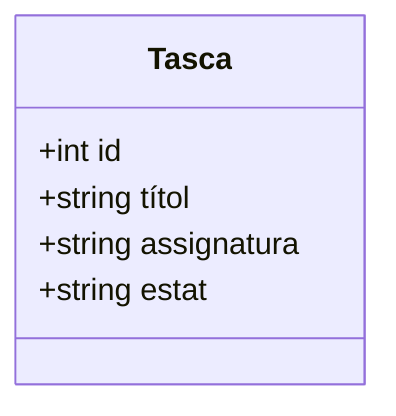

# SPECIFICATIONS.md — Sistema Tasks_app (v1.0)

## 1. Visió General
Tasks_app és una eina CLI lleugera per ajudar als estudiants a gestionar les seves tasques acadèmiques diàries.

## 2. User Stories (Històries d'Usuari)
- US-01: Com a estudiant, vull afegir una tasca amb títol i assignatura per recordar els meus deures.
- US-02: Com a estudiant, vull veure la llista de tasques pendents per organitzar el meu temps.

## 3. Model de Dades (Mermaid)


## 4. Requisits
- RF-01 : El sistema tasks_app ha de guardar les tasques en un fitxer JSON de persistència local.
- RF-02 : Si el fitxer `data/tasks.json` no existeix, el sistema tasks_app ha de crear `data/tasks.json`  inicialitzat amb una llista JSON buida ([])
- RF-03 : El sistema tasks_app ha de proveir a l'estudiant la capacitat de crear una nova tasca amb estat 'pendent' mitjançant el comandament add --title <títol> --subject <assignatura>.
- RF-04: El sistema tasks_app ha de proveir a l’estudiant la capacitat de visualitzar totes les tasques registrades (incloent-hi el seu ID, títol, assignatura i estat) mitjançant el comandament list.

## 5. Criteris d’acceptació i proves (Gherkin scenarios)
- GS-01: Creació correcta d'una tasca
  Atès que la base de dades JSON no conté encara tasques
  quan l’estudiant executa `python src/tasks_app.py add --title 'Pràctica 1' --subject 'RS'
  aleshores el sistema confirma `Tasca [ID: 1] creada amb èxit`
  i la tasca queda registrada al fitxer `data/tasks.json`.

- GS-02: Llistat de tasques quan `data/tasks.json` no conté registres 
  Atès que la base de dades JSON no conté encara tasques
  quan l’estudiant executa `python src/tasks_app.py list`
  aleshores el sistema mostra `Registre de tasques buit.` 

- GS-03: Llistat de tasques quan data/tasks.json conté registres
  Atès que el fitxer `data/tasks.json` conté les següents tasques:
    | id | títol          | assignatura | estat   |
    | 1  | Pràctica 1     | RS          | pendent |
    | 2  | Examen parcial | SO          | pendent |
  quan l’estudiant executa `python src/tasks_app.py list`
  aleshores el sistema mostra per pantalla:
    "[1] Pràctica 1 (RS) - estat: pendent"
    "[2] Examen parcial (SO) - estat: pendent"


---

## Iteració 2 (v2.0): Dates Límit, Edició, Compleció i Alertes

### 2. User Stories (Iteració 2)
* **US-03:** Com a estudiant, vull indicar una data límit en crear una tasca per tal de prioritzar els meus lliuraments i exàmens[cite: 2, 6].
* **US-04:** Com a estudiant, vull modificar qualsevol atribut d'una tasca existent a partir del seu identificador per tal de corregir errors d'introducció o actualitzar dades[cite: 2, 6].
* **US-05:** Com a estudiant, vull marcar una tasca com a completada per tal de diferenciar la feina ja feta de la pendent[cite: 2, 6].
* **US-06:** Com a estudiant, vull veure indicacions de caducitat o urgència en llistar les tasques pendents per tal d'evitar oblidar terminis propers o ja vençuts[cite: 2, 6].

### 3. Model de Dades Actualitzat (Mermaid)
```mermaid
classDiagram
class Tasca {
  +int id
  +string titol
  +string assignatura
  +string estat
  +string data_limit
}
```[cite: 5, 6]

### 4. Requisits (Iteració 2 - Patró SOPHIST)
* **RF-05:** El sistema tasks_app ha de proveir a l'estudiant la capacitat de registrar una data límit amb format `YYYY-MM-DD` en crear una tasca mitjançant l'opció `--due <YYYY-MM-DD>`[cite: 3, 5, 6].
* **RF-06:** El sistema tasks_app ha de proveir a l'estudiant la capacitat de modificar qualsevol atribut d'una tasca existent identificada per `--id <ID>`[cite: 3, 5, 6].
* **RF-07:** El sistema tasks_app ha de proveir a l'estudiant la capacitat de marcar una tasca com a completada identificada per `--id <ID>`[cite: 3, 5, 6].
* **RF-08:** Si una tasca pendent té una data límit anterior al dia actual, el sistema tasks_app ha de mostrar `[CADUCADA]` en llistar-la[cite: 3, 5, 6].
* **RF-09:** Si una tasca pendent té una data límit a menys de 7 dies del dia actual (incloent-hi el dia actual i sense estar caducada), el sistema tasks_app ha de mostrar `[URGENT]` en llistar-la[cite: 3, 5, 6].

### 5. Criteris d'acceptació i proves (Gherkin scenarios - Iteració 2)
* **GS-04: Creació d'una tasca amb data límit**
  * **Atès que** el registre de tasques està buit
  * **Quan** l'estudiant executa `python3 src/tasks_app.py add --title 'Lliurament 2' --subject 'RS' --due 2026-12-15`
  * **Aleshores** el sistema confirma la creació de la tasca i la desa amb la data límit `2026-12-15`[cite: 3, 5, 6].

* **GS-05: Modificació d'un atribut d'una tasca existent per ID**
  * **Atès que** existeix una tasca amb `id: 1`, títol `'Practica 1'`, assignatura `'RS'` i estat `'pendent'`
  * **Quan** l'estudiant executa la comanda de modificació per `--id 1` canviant el títol a `'Pràctica 1'`
  * **Aleshores** la tasca amb `id: 1` actualitza el seu títol a `'Pràctica 1'` i es guarda al fitxer JSON[cite: 3, 5, 6].

* **GS-06: Marcar una tasca com a completada**
  * **Atès que** existeix una tasca amb `id: 1` i estat `'pendent'`
  * **Quan** l'estudiant executa la comanda per completar la tasca amb `--id 1`
  * **Aleshores** l'estat de la tasca amb `id: 1` passa a `'completada'`[cite: 3, 5, 6].

* **GS-07: Tasca pendent caducada en el llistat**
  * **Atès que** el dia actual és `2026-11-24` i existeix una tasca pendent amb data límit `2026-11-10`
  * **Quan** l'estudiant executa `python3 src/tasks_app.py list`
  * **Aleshores** el sistema mostra `[CADUCADA]` en la línia corresponent a aquesta tasca[cite: 3, 5, 6].

* **GS-08: Tasca pendent urgent en el llistat**
  * **Atès que** el dia actual és `2026-11-24` i existeix una tasca pendent amb data límit `2026-11-28`
  * **Quan** l'estudiant executa `python3 src/tasks_app.py list`
  * **Aleshores** el sistema mostra `[URGENT]` en la línia corresponent a aquesta tasca[cite: 3, 5, 6].


---

## Iteració 3 (v3.0): Modes de Llistat i Filtres

### 2. User Stories (Iteració 3)
* **US-07:** Com a estudiant, vull veure un resum de l'estat de les meves tasques (totals, pendents, completades, caducades i urgents) per tal de tenir una visió ràpida de la meva càrrega de treball[cite: 2, 7].
* **US-08:** Com a estudiant, vull llistar les tasques d'una assignatura concreta per tal de centrar-me en una matèria determinada[cite: 2, 7].
* **US-09:** Com a estudiant, vull filtrar les tasques per una paraula clau al títol per tal de trobar ràpidament una tasca específica[cite: 2, 7].

### 4. Requisits (Iteració 3 - Patró SOPHIST)
* **RF-10:** El sistema tasks_app ha de proveir a l'estudiant la capacitat de mostrar un resum amb la quantitat total de tasques i el recompte de tasques pendents, completades, caducades i urgents[cite: 3, 5, 7].
* **RF-11:** El sistema tasks_app ha de proveir a l'estudiant la capacitat de llistar les tasques filtrades per una assignatura concreta[cite: 3, 5, 7].
* **RF-12:** El sistema tasks_app ha de proveir a l'estudiant la capacitat de llistar les tasques que continguin una paraula clau en el títol[cite: 3, 5, 7].

### 5. Criteris d'acceptació i proves (Gherkin scenarios - Iteració 3)
* **GS-09: Resum de l'estat de les tasques**
  * **Atès que** el registre conté tasques en diferents estats i terminis
  * **Quan** l'estudiant executa la comanda de resum de tasques
  * **Aleshores** el sistema mostra el total de tasques i les quantitats corresponents a pendents, completades, caducades i urgents[cite: 3, 5, 7].

* **GS-10: Llistat de tasques per assignatura**
  * **Atès que** existeixen tasques de `'RS'` i d'`'SO'` al registre
  * **Quan** l'estudiant filtra el llistat per l'assignatura `'RS'`
  * **Aleshores** el sistema mostra únicament les tasques corresponents a `'RS'`[cite: 3, 5, 7].

* **GS-11: Llistat de tasques per paraula clau en el títol**
  * **Atès que** existeixen tasques amb títols com `'Pràctica 1'` i `'Examen parcial'`
  * **Quan** l'estudiant filtra el llistat per la paraula clau `'Examen'`
  * **Aleshores** el sistema mostra únicament les tasques el títol de les quals conté `'Examen'`[cite: 3, 5, 7].